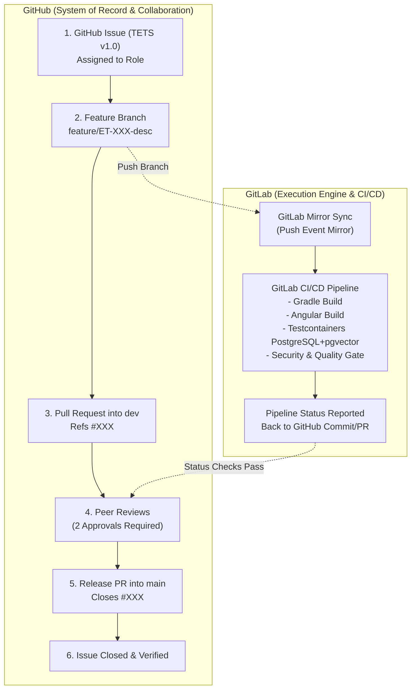

# eTalent Search — Hybrid GitHub/GitLab Automation Workflow

**Standard:** Team Engineering Ticket Standard (TETS) v1.0  
**Effective Date:** 10 November 2026  
**Platforms:** GitHub (Planning, Tracking, Code Review) + GitLab (CI/CD Pipeline Engine)  

---

## 1. Architectural Model & Tool Separation

The eTalent Search engineering delivery operates on a disciplined hybrid workflow leveraging the strengths of both GitHub and GitLab:

### System of Record Responsibilities
- **GitHub:**
  - Single source of truth for all requirements, user stories, and engineering tickets.
  - Issue board tracking (`Backlog` → `Ready` → `In Progress` → `In Review` → `Merged to Dev` → `Done`).
  - Source code version control, branch rulesets, and feature branch hosting.
  - Pull Request workflows, inline code reviews, conversation threads, and sign-offs.
  - Release promotion PRs (`dev` to `main`).
- **GitLab:**
  - Automated repository mirroring from GitHub.
  - Execution of CI/CD pipelines defined in `.gitlab-ci.yml`.
  - Provisioning of ephemeral Docker containers and Testcontainers (PostgreSQL 16 + pgvector).
  - Test execution (JUnit 5, Jasmine/Karma/Playwright), static analysis, and code quality reporting.
  - Deployment artifact packaging (Spring Boot executable jar containing compiled Angular SPA bundle).

---

## 2. Branching & Naming Standards

| Item | Pattern / Convention | Example |
| :--- | :--- | :--- |
| **Default Branch** | `main` | Production-ready, stable baseline |
| **Integration Branch** | `dev` | Active shared integration branch |
| **Feature Branch** | `feature/ET-XXX-description` | `feature/ET-032-project-structure` |
| **Bugfix Branch** | `bugfix/ET-XXX-description` | `bugfix/ET-048-tie-breaking-order` |
| **Technical Task** | `task/ET-XXX-description` | `task/ET-065-gitlab-ci-pipeline` |
| **Commit Message** | `ET-XXX: Description of change` | `ET-032: Scaffold Gradle multi-module layout` |
| **Pull Request Title** | `[ET-XXX] Title matching ticket` | `[ET-032] Establish project structure and Gradle wrapper` |

---

## 3. Pull Request Lifecycle & Promotion Gates

### Step 1: Feature PR (Branch → `dev`)
1. Developer branches from latest `dev`.
2. Developer commits changes with `ET-XXX` prefix.
3. Developer pushes to GitHub; push triggers mirroring to GitLab.
4. GitLab CI executes:
   - `./gradlew check` (Java 21, Checkstyle, Spotless formatting, Unit tests).
   - Angular build and linting (`npm run build`, `npm run lint`).
   - Testcontainers integration test suite against real PostgreSQL + pgvector.
5. GitHub PR displays GitLab pipeline status check.
6. Once CI passes, two peer reviews are requested and required.
7. Authorized maintainer squash-merges into `dev`. Ticket status moves to `Merged to Dev`.

### Step 2: Release PR (`dev` → `main`)
1. When sprint milestones or release cuts are reached, a release PR is created from `dev` into `main`.
2. Release CI runs full suite, including long-running consistency tests and synthetic scale checks.
3. Release PR description lists all included tickets with `Closes #XXX` references.
4. Designated maintainers review and execute a merge commit (preserving history).
5. GitHub automatically closes linked tickets and moves them to `Done`.

---

## 4. GitHub Rulesets & Branch Protections

To enforce quality and governance without enterprise cost:
- **`dev` branch ruleset:**
  - Require pull request before merging.
  - Require at least 2 approvals.
  - Require status checks to pass before merging (GitLab CI pipeline status).
  - Require branches to be up to date before merging.
  - Block force pushes and branch deletion.
- **`main` branch ruleset:**
  - Restrict updates to designated maintainer team only.
  - Require pull request from `dev` only.
  - Require passing release CI status checks.
  - Require at least 1 independent maintainer approval.
