# eTalent Search — Ticket Dependency Graph & Execution Flow

**Standard:** Team Engineering Ticket Standard (TETS) v1.0  
**Project:** eTalent Search  
**Authoritative Specification:** eTalent Search Project Specification v1.0  
**Repository:** [DesireGwanzura/etalent-search](https://github.com/DesireGwanzura/etalent-search)  

---

## 1. Architectural Dependency Flowchart (ET-001 through ET-047)

The following dependency graph maps the critical path across all 47 engineering tickets:

```mermaid
flowchart TD
    subgraph Foundation ["Workstream A: Foundation & Architecture"]
        ET001["ET-001: Project Structure & Gradle"] --> ET002["ET-002: PostgreSQL + pgvector"]
        ET001 --> ET003["ET-003: AI Provider Interfaces"]
        ET001 --> ET004["ET-004: Synthetic Data Generator"]
    end

    subgraph Ingestion ["Workstream C: Candidate Ingestion"]
        ET002 & ET004 --> ET005["ET-005: Candidate File Adapter"]
        ET005 --> ET006["ET-006: Privacy Scrubber & Allowlist"]
        ET003 & ET006 & ET002 --> ET007["ET-007: Extraction & Embeddings"]
        ET007 --> ET008["ET-008: Sync & Mass-Deletion Guard"]
        ET008 --> ET009["ET-009: Sync Status & Audit"]
        ET007 --> ET010["ET-010: Re-processing Trigger"]
    end

    subgraph AI ["Workstream D: AI & Semantic Evaluation"]
        ET003 & ET004 --> ET011["ET-011: AI Feasibility Spike (Early)"]
        ET011 --> ET012["ET-012: Structured JSON Prompts"]
        ET007 & ET011 --> ET013["ET-013: pgvector Semantic Retrieval"]
        ET012 & ET013 --> ET014["ET-014: Parallel Evaluation Orchestrator"]
        ET014 --> ET015["ET-015: AI Fallback & Degraded Mode"]
    end

    subgraph Scoring ["Workstream E: Scoring & Ranking Engine"]
        ET012 & ET014 --> ET016["ET-016: Deterministic Scoring Engine"]
        ET016 --> ET017["ET-017: Tie-Breaking & Instant Re-ranking"]
        ET002 & ET017 --> ET018["ET-018: Ranking Snapshots"]
        ET012 & ET016 --> ET019["ET-019: Faithfulness Validation"]
    end

    subgraph Backend ["Workstream F: Backend & Security"]
        ET001 & ET002 --> ET020["ET-020: Spring Security & RBAC"]
        ET020 & ET016 --> ET021["ET-021: Vacancy Management REST API"]
        ET018 & ET020 & ET021 --> ET022["ET-022: Ranking & Profile Query REST API"]
        ET018 & ET021 --> ET023["ET-023: Shortlist REST API"]
        ET020 --> ET024["ET-024: Admin User & Defaults API"]
        ET020 --> ET025["ET-025: Audit Logging Interceptor"]
    end

    subgraph Frontend ["Workstream G: Frontend Angular SPA"]
        ET001 --> ET026["ET-026: Angular 17+ SPA Setup"]
        ET021 & ET026 --> ET027["ET-027: Vacancy Creation & Weights UI"]
        ET022 & ET026 --> ET028["ET-028: Ranked Results List"]
        ET022 & ET028 --> ET029["ET-029: Candidate Profile Drawer"]
        ET023 & ET028 --> ET030["ET-030: Shortlist Action View"]
        ET021 & ET026 --> ET031["ET-031: Past Vacancies Archive"]
        ET009 & ET024 & ET025 & ET026 --> ET032["ET-032: Admin Console"]
        ET020 & ET026 --> ET033["ET-033: Auth Login & App Shell"]
    end

    subgraph DevOps ["Workstream B: DevOps & CI/CD"]
        ET001 --> ET034["ET-034: GitLab CI/CD Pipeline"]
        ET034 --> ET035["ET-035: GitHub PR Automation"]
        ET034 --> ET036["ET-036: GitHub-GitLab Mirror"]
        ET001 --> ET037["ET-037: Multi-Stage Dockerfile"]
        ET034 --> ET038["ET-038: Static Analysis & Scanners"]
        ET035 & ET036 & ET038 --> ET039["ET-039: GitHub Rulesets & Promotion"]
    end

    subgraph TestingRelease ["Workstream H: Testing, Release & Optional"]
        ET002 & ET004 --> ET040["ET-040: Testcontainers Suite"]
        ET001 --> ET041["ET-041: POPIA Compliance Gate R1"]
        ET004 & ET016 & ET040 --> ET042["ET-042: Consistency & Overlap Tests"]
        ET006 & ET012 & ET020 --> ET043["ET-043: Adversarial & Security Tests"]
        ET022 & ET028 --> ET044["ET-044: Location & Availability Filters"]
        ET023 & ET030 --> ET045["ET-045: Shortlist CSV Export"]
        ET018 & ET028 --> ET046["ET-046: Mark Not Relevant"]
        ET039 & ET040 & ET041 & ET042 & ET043 --> ET047["ET-047: E2E Release 1 Readiness Gate"]
    end
```

---

## 2. Release Gates & Strategic Dependencies

### Gate 1: Early AI Feasibility Spike (`ET-011`)
- **Requirement:** Must execute early in Sprint 1 on the 1,000-candidate synthetic scale set.
- **Purpose:** Empirically measures top-5 overlap (target: 4 of 5), end-to-end latency (target: <= 60s), token costs, and regex scrubber residue.
- **Impact:** Informs candidate cap K, concurrency semaphore settings, and validates the 4-week delivery timeline before deep UI/scoring implementation.

### Gate 2: Legal POPIA Compliance Gate (`ET-041` / Gate R1)
- **External Dependency:** Formal legal review of candidate data reuse basis and AI provider terms (DPA, no model training, known geographical processing location).
- **Decoupled Architecture:** Gate R1 is a **launch gate for real candidate data**, NOT a development blocker. The entire development, testing, and CI pipeline executes against synthetic datasets (`APP_DATA_MODE=SYNTHETIC`) generated in `ET-004`.

### Gate 3: Release 1 Promotion Gate (`ET-039` & `ET-047`)
- **Ruleset Constraint:** Merging from integration branch `dev` into `main` requires passing Release CI (Testcontainers, quality gate, consistency tests) and approval from both designated maintainers.
- **Promotion Checklist:** 100% of Must functional requirements satisfied; <= 60s full ranking latency verified; >= 95% explanation faithfulness achieved.
